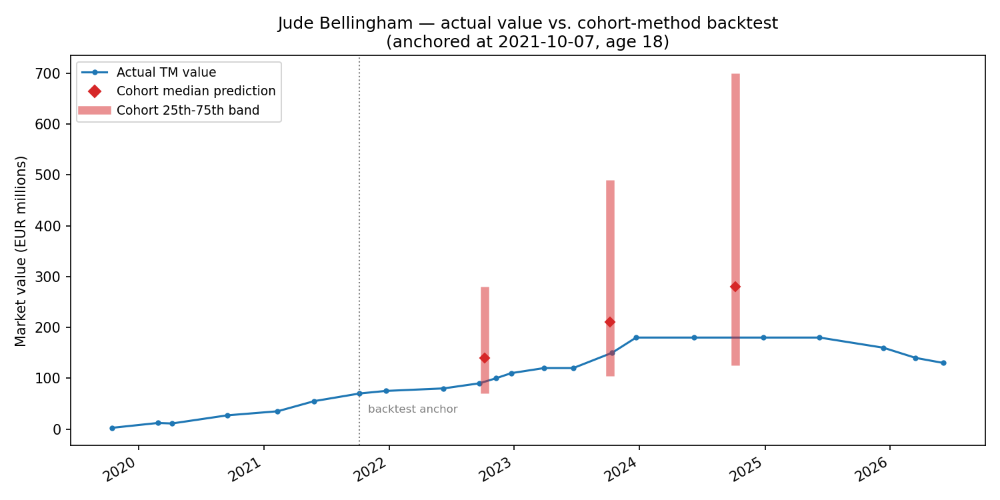

# Market-value trajectory projection

Projects a football player's transfer-market value 1-3 seasons forward from
public Transfermarkt valuation history, two ways:

1. **A nonparametric peer-cohort method** (the "deployed" version) — no
   model is fit; a player's future value range comes from what actually
   happened to real comparable players (same exact age) historically.
2. **A five-method comparison and a SHAP interpretability pass**, to check
   whether a fitted model (gradient boosting, quantile regression) can beat
   the simple cohort method on held-out accuracy, and to understand which
   features actually carry signal.

Built as a generalized, public-data version of a market-value projection
tool originally developed for football-club scouting work — same
methodology, same code, run here on a public, non-confidential example
player instead of a real recruitment target.

## Method 1 — peer-cohort projection

For a given player: anchor on their own (most recent, or a specified past
date for backtesting) valuation, build a cohort of every other player who
was ever valued at that *exact age* (no value-band or position matching —
checked directly that position barely changes the ratio distribution's
shape while cutting the sample 6x), and take the 25th/50th/75th percentile
of that cohort's own future/anchor value ratio at each horizon. The % change
is the primary output; an EUR band is derived from it, not the other way
around — a ratio-based comparison doesn't require matching on value level.

No ML, nothing fitted — a live BigQuery query every run, entirely
auditable, with the sample size (`n_players`) printed for every horizon so
a thin, unreliable cohort is visible rather than hidden.

### Backtest: Jude Bellingham, anchored 2021-10-07 (age 18, €70M)

Picked because his real value history has both a dramatic rise *and* a
real post-peak decline (€180M in 2023-24 down to €130M by mid-2026) — a
genuine stress test of the method, not a cherry-picked one-way story.

| Horizon | Predicted (low/base/high) | Actual realized ratio | Actual value |
|---|---|---|---|
| +1 season (→ 2022-09-21, nearest match) | +0% / +100% / +300% | **+29%** | €90M |
| +2 seasons (→ 2023-10-13) | +50% / +200% / +600% | **+114%** | €150M |
| +3 seasons (→ 2024-12-27) | +80% / +300% / +900% | **+157%** | €180M |



**Honest read of this result**: at every horizon, Bellingham's actual rise
landed inside the predicted band but in the lower half of it — below the
cohort median, well above the low end. Even a player who went on to become
one of the most expensive footballers alive didn't beat the cohort's
*median* projection at any of the three horizons. That's a genuinely
useful, non-obvious finding about the method: the cohort median isn't
systematically too conservative even for an outlier talent, which is
reassuring about calibration — but it's one backtest, one player, not a
validated general claim (see Method 2 for the real held-out accuracy
numbers across the full population).

### Live projection, today (age 23, €130M)

```
Peer cohort — exact age 23, position-mode=off:
Season     n_players       Low      Base      High          Low €      Base €      High €
+1 season      19644      -17%      +14%      +67%   €108,333,333€147,727,273€216,666,667
+2 seasons     17730      -20%      +27%     +122%   €104,000,000€165,454,545€288,888,889
+3 seasons     15937      -23%      +33%     +161%   €100,000,000€173,333,333€339,130,435
```

Full output, including the transfer-fee overlay: `output/live_projection.txt`.

## Method 2 — does a fitted model beat the cohort method?

`mv_trajectory_model_comparison.py` pulls ~1.15M rows (valuations,
transfers, performance stats) and holdout-backtests (80/20 split) five
methods — the empirical cohort bucket, quantile regression, XGBoost,
LightGBM, and sklearn's HistGradientBoostingRegressor — against each other
on pinball loss and interval coverage. Full results: `output/model_comparison.txt`.

**Real run, 1,151,750 rows after cleaning.** LightGBM wins on pinball loss
at every horizon (lower is better), and every tree-based method's interval
coverage lands within a point of the 50% target — well-calibrated, not
just low-error:

| Horizon | Method | pin25 | pin75 | coverage |
|---|---|---|---|---|
| +1 season | XGBoost | 0.1546 | 0.1705 | 49.7% |
| +1 season | **LightGBM** | **0.1543** | **0.1701** | 49.5% |
| +1 season | HistGB (sklearn) | 0.1547 | 0.1703 | 49.6% |
| +3 seasons | XGBoost | 0.2482 | 0.2591 | 50.0% |
| +3 seasons | **LightGBM** | **0.2473** | **0.2579** | 49.8% |
| +3 seasons | HistGB (sklearn) | 0.2479 | 0.2589 | 49.9% |

The margin between the three gradient-boosting methods is small — which
boosting library wins matters far less than the feature set feeding it.
Quantile regression's intervals are visibly narrower/lower than the
tree methods' at every horizon (e.g. +3yr base 0.470 vs. LightGBM's 0.807)
— the linear/additive assumption underfits a genuinely nonlinear
relationship between these features and value growth.

`mv_trajectory_shap_analysis.py` runs SHAP on the best-performing model to
check which engineered features (age, log-value, `value_drawdown` —
log-distance below a player's own trailing-peak value, `momentum_1yr`,
minutes-share, transfer-recency) actually carry signal vs. which are
noise, and why. Full results: `output/shap_analysis.txt`.

**Real run, global importance (mean |SHAP|, n=30,000 holdout rows, +1
season horizon)**: `age` (0.135) and `log_value` (0.120) dominate, followed
by `value_drawdown` (0.085) and `days_since_last_transfer` (0.060) as the
next real tier. Everything from `height_in_cm` down (0.011 and below) is
weak-to-negligible — `position` (0.0002) and `minutes_share_missing`
(~0.0000) carry essentially no signal once the stronger features are
present. Correlation check flags `prior_season_minutes` / `minutes_share`
(r=0.911, expected — one is a normalization of the other) and `age` /
`value_drawdown` (r=-0.611 — older players sit further below their own
career peak on average, a real aging-curve echo, not a bug).

**Bellingham's own breakdown** (predicted 0.816x vs. a 1.086x population
average at this age — i.e. the model expects him to *underperform* the
typical same-age trajectory over the next season): `log_value` is the
dominant drag (being already one of the most expensive players alive
leaves less room to grow, in log terms), `value_drawdown` and
`momentum_1yr` both push down too (he's below his own trailing peak and
on a recent-value decline, which the README's backtest chart shows
plainly), while `age=23` and `days_since_last_transfer=1200` push up. A
coherent, explainable story — not a black-box number.

**A bug caught while building this**: the original SHAP script's
player-specific target dict was missing the `position` key that
`CAT_FEATS` requires, so the per-player breakdown crashed outright —
caught by actually running it end-to-end here rather than assuming an
already-working script. Fixed by adding a `--position` flag (default
`"Attack"`, matching the comparison script's convention).

**Point-in-time safety, taken seriously**: two fields that look useful —
a player's *current* contract-expiration date and *all-time-peak* value —
are deliberately excluded from every model. Both are today's-snapshot
fields; using them on a historical training row would leak information
(a future renewal, a later peak) that wasn't knowable as of that row's
actual anchor date. `value_drawdown` is instead computed from a windowed
`MAX() OVER (... ROWS BETWEEN UNBOUNDED PRECEDING AND CURRENT ROW)` over
valuation history only, so it only ever sees the past.

## Data

Public Transfermarkt valuation/transfer/appearance history, queried from
BigQuery (`real-zaragoza-500608.raw_transfermarkt_datasets`) — Transfermarkt
publishes this data on its own site; this project uses an existing public
mirror/extraction of it, not a private source.

## Limitations

- The cohort method matches on age only — it doesn't condition on the
  player's own performance trend beyond what `value_drawdown`/`momentum_1yr`
  already capture in Method 2's richer feature set.
- Survivorship bias: a cohort row only counts at a horizon if that player
  still has a later valuation at all — players who drop out of tracked
  football are silently excluded, biasing bands upward.
- Valuations are a periodic snapshot (~2x/year per player), so "N years
  forward" is a nearest match within a tolerance window, not an exact
  anniversary.
- One backtest on one (extreme, high-profile) player is illustrative, not
  a validated general accuracy claim — Method 2's holdout metrics across
  the full population are the real evidence of accuracy.

## Running it

```
python3 -m venv .venv && source .venv/bin/activate
pip install -r requirements.txt
gcloud auth application-default login   # needs your own GCP project with this data, or adapt the queries to another source
python scripts/mv_trajectory_projection.py --player-id 581678
python scripts/mv_trajectory_projection.py --player-id 581678 --as-of-date 2021-10-07
python scripts/mv_trajectory_model_comparison.py --player-id 581678 --age 23 --value 130000000 \
  --sub-position "Attacking Midfield" --foot right --height 186 --peak-value 180000000 \
  --value-1yr-ago 160000000 --prior-season-minutes 1608 --prior-season-goals 5 \
  --prior-season-assists 2 --days-since-last-transfer 1200
python scripts/plot_backtest.py
```
